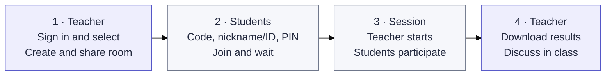

# Exp-all-in-one

[日本語](README.md) · [中文](README.zh-CN.md) · [English](README.en.md)

A classroom experiment platform with one entry point for Double Auction, EMH, and Judgement under Uncertainty. The interface opens in Japanese by default.

Student waiting screens share a consistent card design while retaining experiment-specific information.

[Teacher entry](https://exp-all-in-one.vercel.app/teacher) · [Student entry](https://exp-all-in-one.vercel.app) (the teacher entry has a separate URL)

The EMH order book shows price and quantity and marks your resting orders in both the list and bar chart. Teachers can find buyer and seller numbers in the trade records and CSV export. On each side, the limit and market buttons sit side by side, with estimated profit based on your remaining dividends below each button. Unfilled limits queue by price, then arrival time, until period end. You can amend or cancel them. Draft bid and ask prices also stay in their fields throughout the period.

## Get started

The teacher creates and shares a room, and students join with its code, using a nickname or student ID as instructed by the teacher. The teacher chooses the experiment, explains the rules, and downloads the results after the session.

Enter the teacher key once at the teacher entry. The same browser stays signed in for eight hours across reloads, experiment changes, room creation and management. Sign in again after logout, expiry or a key change; each room keeps its separate teacher password.

EMH labels prices, dividends, trading balances and scores in yen.

After the teacher starts EMH, a five-second countdown appears in the center of the student screen while students review their conditions; trading opens when it ends.

EMH Demo Model supports both experiments. Experiment 2 defaults to a 12-person market and uses separate practice dividends and states. Students see their state-contingent dividends and probabilities. In both experiments, students see buy and sell controls in separate columns, market prices, and personal records together; teachers can expand or collapse conditions during play. Open `/emh/demo/preview` to view the demo at different screen sizes.

Everyone can quote in EMH. Accepting an opposing price or submitting a crossing quote immediately trades one unit. Students see anonymous trade records and their own resting orders highlighted in the book; Experiment 1 scores are marked provisional until period B ends.

Experiment 2 configures initial securities, the unsuccessful-attempt limit, insider start round and number per type, state probabilities, dividends, realized states, market count, target size and type ratios. Market count may be automatic or specified; actual attendance is split into markets of 3–999. Defaults are a target of 12, two securities, two unsuccessful attempts and up to two insiders per type from round 3.

The EMH demo control panel switches between teacher and student views, pauses, advances 30 seconds or to the next period, restarts, and returns to settings. Fast-forward processes virtual trades and deadlines in order; it is disabled during the countdown and while paused. **やり直す** keeps the settings and resets allocation and progress. The screen-size preview places the control panel outside the frame.

[Illustrated instructions, re-entry, and room management](docs/guide/en/classroom.md) · [Using Demo Model](docs/guide/en/demo.md)

Use **Demo Model** on the teacher experiment selection page to choose a demo. The demo list and screens use a yellow theme, with a demo-mode label beside the site name. The blue-purple **DEMOモードを終了** button returns to the student entry. Each demo setup offers **戻る** to return to the list and **教員用ページへ** to return to the teacher page.

Judgement teacher pages and the demo share task cards, the selection list and controls, with Japanese, Chinese and English switching and settings locked during a run.

## Experiments

| Experiment                  | Scope                                                                                                                                             | Guide                                             | Demo                                                          |
| --------------------------- | ------------------------------------------------------------------------------------------------------------------------------------------------- | ------------------------------------------------- | ------------------------------------------------------------- |
| Double Auction              | Compare CDA, Call Market, and Posted Offer; allocate markets and roles using actual attendance                                                    | [Flow and rules](docs/guide/en/double-auction.md) | [Demo Model](https://exp-all-in-one.vercel.app/demo)          |
| EMH                         | Configure round count, round, trade and break durations in both experiments; Experiment 2 also configures participants, information and dividends | [Flow and rules](docs/guide/en/emh.md)            | [Demo Model](https://exp-all-in-one.vercel.app/emh/demo)      |
| Judgement under Uncertainty | 14 judgment and cognitive bias tasks, condition assignment, task and option ordering, timing, and Japanese/Chinese/English display                | [Flow and data](docs/guide/en/judgment.md)        | [Demo Model](https://exp-all-in-one.vercel.app/judgment/demo) |

## Development and materials

Built with Next.js / React / TypeScript, deployed on Vercel + Neon PostgreSQL, and run with Node.js 24.x. Released experiments are independent modules maintained together on `main`.

The **Documentation sync** PR check warns about missing Japanese, Chinese, or English updates to READMEs and related guides.

- [Local setup, environment variables, deployment, and verification](docs/guide/en/development.md)
- [Architecture and development policy](docs/architecture.md)
- [Experiment materials index (Japanese and original materials)](material/README.md)
- [EMH source materials and protocol mapping (Japanese)](docs/experiments/emh.md)
- [Judgment sources, implementation scope, and limitations](docs/upstream/judgment/README.en.md)
- [Migration and verification record](docs/releases/unified-platform-migration.md)

[GitHub and issue tracker](https://github.com/DKshawn/Exp-all-in-one/issues) · [Vercel project](https://vercel.com/dkshawns-projects/exp-all-in-one)
