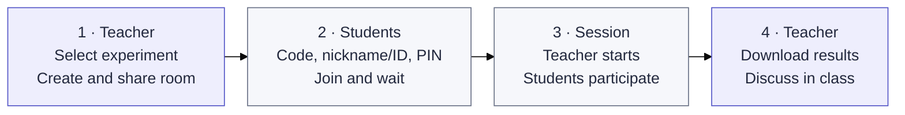

# Exp-all-in-one

[日本語](README.md) · [中文](README.zh-CN.md) · [English](README.en.md)

A classroom experiment platform with one entry point for Double Auction, EMH, and Judgement under Uncertainty. The interface opens in Japanese by default.

[Teacher entry](https://exp-all-in-one.vercel.app/teacher) · [Student entry](https://exp-all-in-one.vercel.app)

## Get started

The teacher creates and shares a room, and students join with its code, using a nickname or student ID as instructed by the teacher. The teacher chooses the experiment, explains the rules, and downloads the results after the session.

After a teacher key opens the room management list, its input is hidden; refresh and deletion on the same page reuse the entered key.

[Illustrated instructions, re-entry, and room management](docs/guide/en/classroom.md) · [Using Demo Model](docs/guide/en/demo.md)

## Experiments

| Experiment                  | Scope                                                                                                                              | Guide                                             | Demo                                                          |
| --------------------------- | ---------------------------------------------------------------------------------------------------------------------------------- | ------------------------------------------------- | ------------------------------------------------------------- |
| Double Auction              | Compare CDA, Call Market, and Posted Offer; allocate markets and roles using actual attendance                                     | [Flow and rules](docs/guide/en/double-auction.md) | [Demo Model](https://exp-all-in-one.vercel.app/demo)          |
| EMH                         | Asset markets with different dividend types; automatically group everyone into markets of about nine, with six default rounds      | [Flow and rules](docs/guide/en/emh.md)            | [Demo Model](https://exp-all-in-one.vercel.app/emh/demo)      |
| Judgement under Uncertainty | 14 judgment and cognitive bias tasks, condition assignment, task and option ordering, timing, and Japanese/Chinese/English display | [Flow and data](docs/guide/en/judgment.md)        | [Demo Model](https://exp-all-in-one.vercel.app/judgment/demo) |

## Development and materials

Built with Next.js / React / TypeScript, deployed on Vercel + Neon PostgreSQL, and run with Node.js 24.x. Released experiments are independent modules maintained together on `main`.

The **Documentation sync** PR check warns about missing Japanese, Chinese, or English updates to READMEs and related guides.

- [Local setup, environment variables, deployment, and verification](docs/guide/en/development.md)
- [Architecture and development policy](docs/architecture.md)
- [Experiment materials index (Japanese and original materials)](material/README.md)
- [EMH source materials and protocol mapping (Japanese)](docs/experiments/emh.md)
- [Judgment sources, implementation scope, and limitations](docs/upstream/judgment/README.en.md)
- [Migration and verification record](docs/releases/unified-platform-migration.md)

[GitHub and issue tracker](https://github.com/DKshawn/Exp-all-in-one/issues) · [Vercel project](https://vercel.com/dkshawns-projects/exp-all-in-one)
