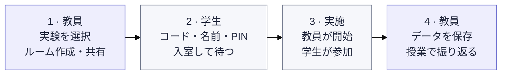

# Exp-all-in-one

[日本語](README.md) · [中文](README.zh-CN.md) · [English](README.en.md)

Double Auction、EMH、Judgement under Uncertainty を一つの入口から実施する授業用実験プラットフォームです。初期表示は日本語です。

[教員入口](https://exp-all-in-one.vercel.app/teacher) · [学生入口](https://exp-all-in-one.vercel.app)

## 使い始める

教員がルームを作り、学生は共有されたコードで入室します。開始後は各自の画面に従って参加し、教員が結果をダウンロードします。

[画面で見る使い方・再入室・ルーム管理](docs/guide/ja/classroom.md) · [Demo Model の使い方](docs/guide/ja/demo.md)

## 実験

| 実験                        | 内容                                                                          | ガイド                                          | デモ                                                          |
| --------------------------- | ----------------------------------------------------------------------------- | ----------------------------------------------- | ------------------------------------------------------------- |
| Double Auction              | CDA・Call Market・Posted Offer の制度比較。実人数に応じた市場・役割の割り当て | [実施とルール](docs/guide/ja/double-auction.md) | [Demo Model](https://exp-all-in-one.vercel.app/demo)          |
| EMH                         | 配当の異なる資産市場。全員を約9人ずつに自動分け、既定の6ラウンドを実施        | [実施とルール](docs/guide/ja/emh.md)            | [Demo Model](https://exp-all-in-one.vercel.app/emh/demo)      |
| Judgement under Uncertainty | 判断・認知バイアスの14課題。条件割り当て、課題順・選択肢順、計時、日中英表示  | [実施と記録](docs/guide/ja/judgment.md)         | [Demo Model](https://exp-all-in-one.vercel.app/judgment/demo) |

## 開発と資料

Next.js / React / TypeScript、Vercel + Neon PostgreSQL。Node.js 24.x を使います。正式な実験は同じ `main` で独立モジュールとして管理します。

PR の **Documentation sync** チェックは、日中英の README と関連ガイドの更新漏れを警告します。

- [ローカル起動・環境変数・デプロイ・検証](docs/guide/ja/development.md)
- [構成と開発方針（English）](docs/architecture.md)
- [実験資料](material/README.md)
- [EMH の原資料と実施条件](docs/experiments/emh.md)
- [Judgment の原典・実施範囲・制約](docs/upstream/judgment/README.md)
- [移行・検証記録（English）](docs/releases/unified-platform-migration.md)

[GitHub・問い合わせ](https://github.com/DKshawn/Exp-all-in-one/issues) · [Vercel プロジェクト](https://vercel.com/dkshawns-projects/exp-all-in-one)
