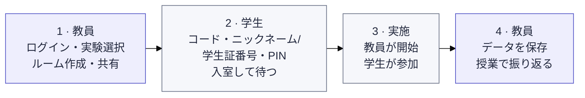

# Exp-all-in-one

[日本語](README.md) · [中文](README.zh-CN.md) · [English](README.en.md)

Double Auction、EMH、Judgement under Uncertainty を一つの入口から実施する授業用実験プラットフォームです。初期表示は日本語です。

学生の待機画面は共通のカードデザインを使い、実験ごとの情報を表示します。

[教員入口](https://exp-all-in-one.vercel.app/teacher) · [学生入口](https://exp-all-in-one.vercel.app)（教員入口は学生画面とは別のURLです）

EMH の注文板は価格と数量を表示し、自分の指値は「一覧」と「棒グラフ」の両方で分かります。教員は取引記録と CSV で買い手・売り手の番号を確認できます。買い・売りそれぞれで指値注文と成行注文を横に並べ、各ボタンの下に残り配当に基づく「見込利益」を表示します。未成立の指値は期末まで価格順、同額では受付順に並び、本人が変更・取消できます。入力中の買値・売値も同じ期の取引間で保持します。

## 使い始める

教員がルームを作って共有し、学生はコードで入室し、教員の指示に応じてニックネームまたは学生証番号を入力します。実施する実験とルールは教員が案内し、終了後に教員が結果をダウンロードします。

教員用キーは教員入口で一度だけ入力します。同じブラウザーでは8時間、再読込・実験切替・ルーム作成・管理で再入力せずに使えます。「ログアウト」、有効期限切れ、キー変更後は再認証します。ルームごとの教員パスワードは別に保持します。

EMHの価格・配当・売買収支・得点は円で表示します。

EMHは開始操作後、学生画面の中央に5秒のカウントダウンを表示し、学生が条件を確認してから取引を開始します。

EMHの Demo Model では実験1と実験2を選べます。実験2は既定12人の市場と練習用の配当・状態を使い、学生は状態別条件を確認できます。どちらの実験でも、学生画面に左右に分けた買売操作・市場価格・自分の記録を同時に表示します。進行中の教員画面では条件を開閉できます。 画面サイズ別のプレビューは `/emh/demo/preview` で開けます。

EMHでは全員が提示でき、相手の価格を受ける操作と跨ぐ提示は1単位が即時成立します。学生は匿名の取引記録と注文板で自分の未成立の指値を確認でき、実験1の得点にはB期末まで「暫定」と表示します。

実験2では初期証券数、連続不成立回数、内部情報の開始ラウンド・各タイプ人数、状態確率・配当・実現状態、市場数・目標人数・タイプ比率を設定できます。市場数は自動または指定で、実人数を各市場3〜999人に分けます。既定は12人、初期2単位、連続2回不成立、第3ラウンドから各タイプ最大2人です。

EMHデモの操作パネルでは、教員・学生画面の切替、一時停止、30秒進める、次の期へ進む、やり直す、設定の見直しができます。時間を進めると仮想参加者の取引と期限も順に処理されます。カウントダウン中や一時停止中は早送りできません。「やり直す」は設定を保って割り当てと進行をリセットします。画面サイズ別プレビューでは操作パネルを枠外に表示します。

[画面で見る使い方・再入室・ルーム管理](docs/guide/ja/classroom.md) · [Demo Model の使い方](docs/guide/ja/demo.md)

教員の実験選択画面にある **Demo Model** からデモの実験を選べます。 デモ一覧と各デモ画面は黄色系で表示し、ヘッダーの「市場実験室」の横に「DEMOモード」を表示します。正式画面と同じ青紫色の「DEMOモードを終了」で学生入口へ戻れます。各デモの設定画面には「戻る」と「教員用ページへ」があります。

Judgement の教員画面と Demo は課題カード・選択一覧・操作欄を共用します。日中英を切り替えられ、実施中の条件は固定されます。

## 実験

| 実験                        | 内容                                                                                           | ガイド                                          | デモ                                                          |
| --------------------------- | ---------------------------------------------------------------------------------------------- | ----------------------------------------------- | ------------------------------------------------------------- |
| Double Auction              | CDA・Call Market・Posted Offer の制度比較。実人数に応じた市場・役割の割り当て                  | [実施とルール](docs/guide/ja/double-auction.md) | [Demo Model](https://exp-all-in-one.vercel.app/demo)          |
| EMH                         | 両実験でラウンド数・各ラウンド、1取引と休憩の時間を設定可能。実験2は人数・情報・配当も設定可能 | [実施とルール](docs/guide/ja/emh.md)            | [Demo Model](https://exp-all-in-one.vercel.app/emh/demo)      |
| Judgement under Uncertainty | 判断・認知バイアスの14課題。条件割り当て、課題順・選択肢順、計時、日中英表示                   | [実施と記録](docs/guide/ja/judgment.md)         | [Demo Model](https://exp-all-in-one.vercel.app/judgment/demo) |

## 開発と資料

Next.js / React / TypeScript、Vercel + Neon PostgreSQL。Node.js 24.x を使います。正式な実験は同じ `main` で独立モジュールとして管理します。

PR の **Documentation sync** チェックは、日中英の README と関連ガイドの更新漏れを警告します。

- [ローカル起動・環境変数・デプロイ・検証](docs/guide/ja/development.md)
- [構成と開発方針（English）](docs/architecture.md)
- [実験資料](material/README.md)
- [EMH の原資料と実施条件](docs/experiments/emh.md)
- [Judgment の原典・実施範囲・制約](docs/upstream/judgment/README.md)
- [移行・検証記録（English）](docs/releases/unified-platform-migration.md)

[GitHub・問い合わせ](https://github.com/DKshawn/Exp-all-in-one/issues) · [Vercel プロジェクト](https://vercel.com/dkshawns-projects/exp-all-in-one)
