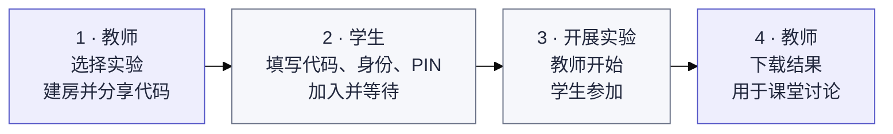

# Exp-all-in-one

[日本語](README.md) · [中文](README.zh-CN.md) · [English](README.en.md)

面向课堂的统一实验平台，通过同一个入口开展 Double Auction、EMH 和 Judgement under Uncertainty。界面默认使用日语。

[教师入口](https://exp-all-in-one.vercel.app/teacher) · [学生入口](https://exp-all-in-one.vercel.app)

## 开始使用

教师创建并分享房间，学生凭代码加入。实验由教师安排并讲解规则，结束后由教师下载结果。

[图解操作、重新进入与房间管理](docs/guide/zh-CN/classroom.md) · [Demo Model 使用说明](docs/guide/zh-CN/demo.md)

## 实验

| 实验                        | 内容                                                                     | 指南                                             | 演示                                                          |
| --------------------------- | ------------------------------------------------------------------------ | ------------------------------------------------ | ------------------------------------------------------------- |
| Double Auction              | 比较 CDA、Call Market、Posted Offer 三种制度，按实际人数分配市场与角色   | [流程与规则](docs/guide/zh-CN/double-auction.md) | [Demo Model](https://exp-all-in-one.vercel.app/demo)          |
| EMH                         | 不同分红类型的资产市场，将所有参加者按每组约9人自动分组，使用默认6轮设置 | [流程与规则](docs/guide/zh-CN/emh.md)            | [Demo Model](https://exp-all-in-one.vercel.app/emh/demo)      |
| Judgement under Uncertainty | 14项判断与认知偏差任务，支持条件分配、任务与选项顺序、计时及日中英显示   | [流程与数据](docs/guide/zh-CN/judgment.md)       | [Demo Model](https://exp-all-in-one.vercel.app/judgment/demo) |

## 开发与资料

技术栈为 Next.js / React / TypeScript，部署使用 Vercel + Neon PostgreSQL，运行环境为 Node.js 24.x。正式实验以独立模块共同维护在 `main` 分支。

PR 中的 **Documentation sync** 检查会提醒日中英 README 及相关指南中遗漏的更新。

- [本地启动、环境变量、部署与验证](docs/guide/zh-CN/development.md)
- [架构与开发约定（英文）](docs/architecture.md)
- [实验材料目录（日文及原始材料）](material/README.md)
- [EMH 原始材料与实施条件（日文）](docs/experiments/emh.md)
- [Judgment 原始出处、实施范围与限制](docs/upstream/judgment/README.zh-CN.md)
- [迁移与验证记录（英文）](docs/releases/unified-platform-migration.md)

[GitHub 与问题反馈](https://github.com/DKshawn/Exp-all-in-one/issues) · [Vercel 项目](https://vercel.com/dkshawns-projects/exp-all-in-one)
