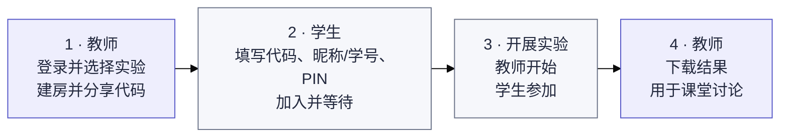

# Exp-all-in-one

[日本語](README.md) · [中文](README.zh-CN.md) · [English](README.en.md)

面向课堂的统一实验平台，通过同一个入口开展 Double Auction、EMH 和 Judgement under Uncertainty。界面默认使用日语。

学生等待画面使用统一的卡片设计，并保留各实验的信息。

[教师入口](https://exp-all-in-one.vercel.app/teacher) · [学生入口](https://exp-all-in-one.vercel.app)（教师入口使用独立地址）

## 开始使用

教师创建并分享房间，学生凭代码加入，按教师要求填写昵称或学号。实验由教师安排并讲解规则，结束后由教师下载结果。

教师密钥只在教师入口输入一次。同一浏览器在8小时内，刷新、切换实验、创建和管理房间都无需再次输入。退出登录、会话到期或密钥更换后需重新验证；每个房间的教师密码仍单独保留。

EMH 的价格、分红、买卖收支与得分在界面上均以「円」标注。

EMH 在教师开始后先在学生画面中央显示5秒倒计时，学生可查看自己的条件，倒计时结束后才开始交易。

EMH Demo Model 支持实验1和实验2；实验2默认使用12人市场及单独的练习分红与状态，学生可查看各状态条件；两个实验的学生均可同时查看左右分开的买卖操作、市场价格和个人记录。教师可展开或收起条件。 可在 `/emh/demo/preview` 切换屏幕尺寸查看演示。

实验2可设置初始证券数、连续未成交结束次数、内部信息开始轮次及各类型人数、状态概率、分红、实际状态、市场数、目标人数和类型比例。市场数可自动确定或手动指定，并按实际到场人数分成每市场3～999人；默认目标12人、初始2单位、连续2次未成交结束、第3轮起每种类型最多2人知情。

EMH 演示控制面板支持切换教师与学生画面、暂停、前进30秒、进入下一期、重新开始和返回设置。快进时会依次处理虚拟参加者的交易和计时期限；倒计时或暂停期间不能快进。「やり直す」保留设置并重置分配和进度。屏幕尺寸预览将控制面板放在画框外。

[图解操作、重新进入与房间管理](docs/guide/zh-CN/classroom.md) · [Demo Model 使用说明](docs/guide/zh-CN/demo.md)

从教师实验选择页的 **Demo Model** 进入统一演示列表，再选择实验。 演示列表和各实验的演示画面采用黄色系，页眉的「市場実験室」旁显示「DEMOモード」；点击与正式画面同为蓝紫色的「DEMOモードを終了」返回学生入口。各 Demo 设置页可通过「戻る」返回列表，或通过「教員用ページへ」返回教师页面。

Judgement 教师页面和 Demo 共用任务卡片、已选列表和操作区，支持日中英切换，实验开始后锁定条件。

## 实验

| 实验                        | 内容                                                                   | 指南                                             | 演示                                                          |
| --------------------------- | ---------------------------------------------------------------------- | ------------------------------------------------ | ------------------------------------------------------------- |
| Double Auction              | 比较 CDA、Call Market、Posted Offer 三种制度，按实际人数分配市场与角色 | [流程与规则](docs/guide/zh-CN/double-auction.md) | [Demo Model](https://exp-all-in-one.vercel.app/demo)          |
| EMH                         | 两种实验可设置轮数、每轮、单次交易和休息时间；实验2可设置人数、内部信息及分红          | [流程与规则](docs/guide/zh-CN/emh.md)            | [Demo Model](https://exp-all-in-one.vercel.app/emh/demo)      |
| Judgement under Uncertainty | 14项判断与认知偏差任务，支持条件分配、任务与选项顺序、计时及日中英显示 | [流程与数据](docs/guide/zh-CN/judgment.md)       | [Demo Model](https://exp-all-in-one.vercel.app/judgment/demo) |

## 开发与资料

技术栈为 Next.js / React / TypeScript，部署使用 Vercel + Neon PostgreSQL，运行环境为 Node.js 24.x。正式实验以独立模块共同维护在 `main` 分支。

PR 中的 **Documentation sync** 检查会提醒日中英 README 及相关指南中遗漏的更新。

- [本地启动、环境变量、部署与验证](docs/guide/zh-CN/development.md)
- [架构与开发约定（英文）](docs/architecture.md)
- [实验材料目录（日文及原始材料）](material/README.md)
- [EMH 原始材料与实施条件（日文）](docs/experiments/emh.md)
- [Judgment 原始出处、实施范围与限制](docs/upstream/judgment/README.zh-CN.md)
- [迁移与验证记录（英文）](docs/releases/unified-platform-migration.md)

[GitHub 与问题反馈](https://github.com/DKshawn/Exp-all-in-one/issues) · [Vercel 项目](https://vercel.com/dkshawns-projects/exp-all-in-one)
