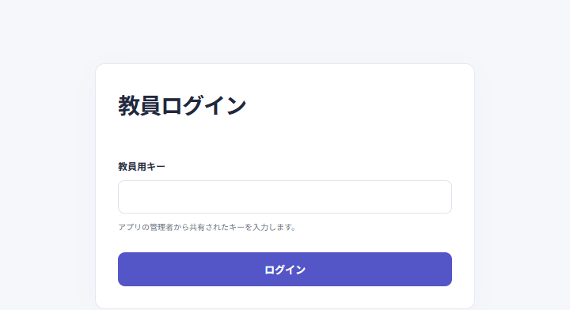
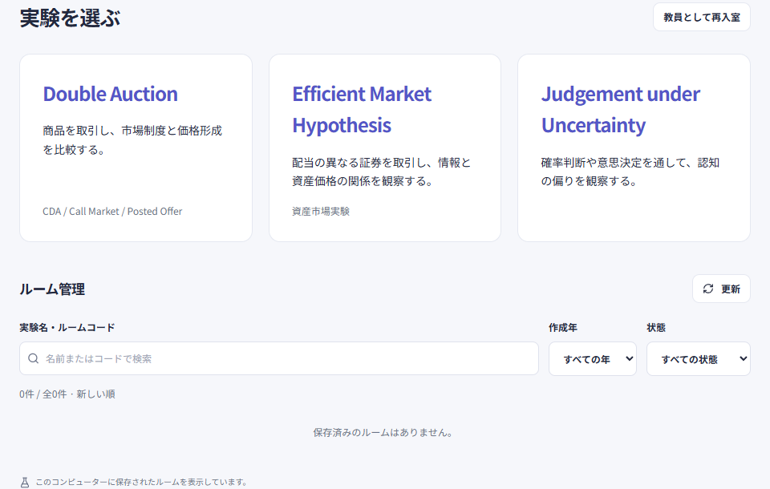
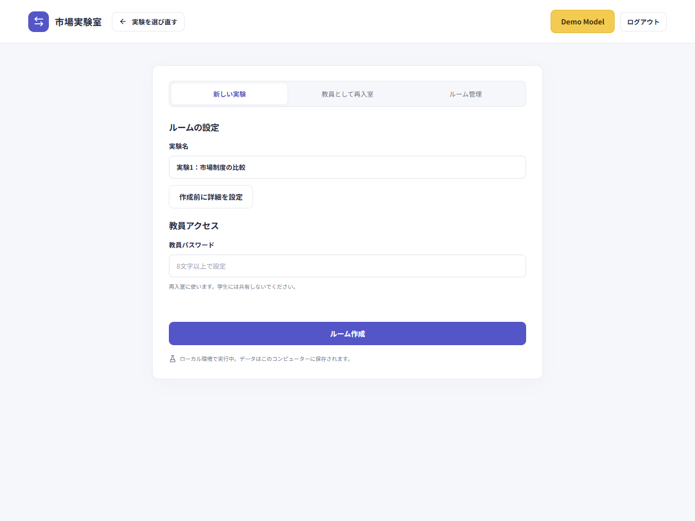
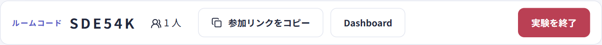
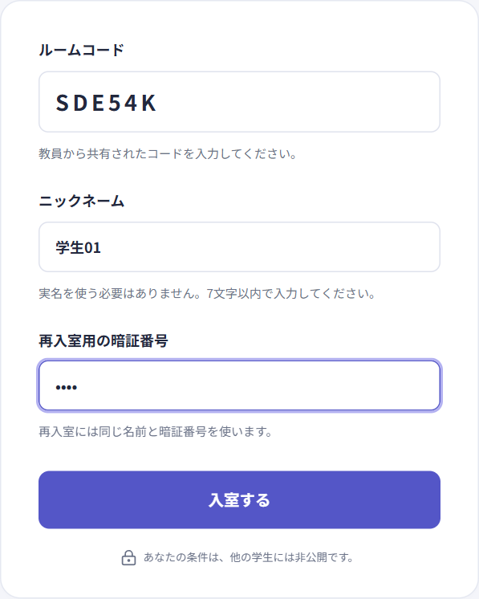
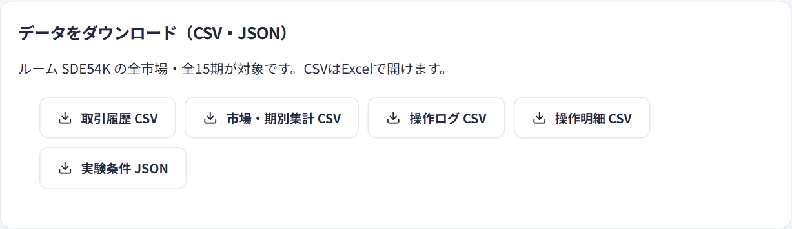

# Illustrated platform guide

[日本語](../ja/classroom.md) · [中文](../zh-CN/classroom.md) · [English](../en/classroom.md)

Student waiting screens use a consistent design. In EMH, a five-second preparation countdown appears in the center of the student screen after the teacher starts, before trading begins.

[Teacher entry](https://exp-all-in-one.vercel.app/teacher) · [Student entry](https://exp-all-in-one.vercel.app)

Create a room, bring students in, run the experiment, and download the results. Screenshots show a local sample classroom in the default Japanese interface; use the online entry links above for class. The creation and download panels use Double Auction as the example.

On experiment setup and re-entry pages, use **戻る** in the header to return to experiment selection. When opening settings from a Double Auction room, **ルーム … に戻る** in the same header returns to that room.

Judgement room creation places task cards beside the selection and create controls; on narrow screens controls appear above the cards. See the [Judgement guide](judgment.md) for language switching and controls during a run.

In CDA and EMH, switch the order book between the list (一覧) and the bar chart (棒グラフ). Student views mark their own orders and omit other participant identifiers. Each experiment module keeps its own order and settlement rules.

## 1. Choose an experiment and create a room

Open the teacher entry, enter the administrator-provided **教員用キー**, and click **ログイン**. After authentication, select an experiment or manage saved rooms from the same entry.

Enter the experiment name, review settings and set a room teacher password of at least eight characters. Click **ルーム作成** to open the teacher view; the teacher key is not requested again.

EMH supports initial securities, target market size, type ratios and period duration. Save settings while admission is open; confirming allocation locks the conditions. See [EMH settings](emh.md).

| Item                                   | Used by                             | Purpose                                                                                   |
| -------------------------------------- | ----------------------------------- | ----------------------------------------------------------------------------------------- |
| Teacher key — 教員用キー               | Teachers                            | Provided by the administrator for teacher-entry login                                     |
| Room teacher password — 教員パスワード | Teacher                             | Set when creating a room; used to re-enter that room                                      |
| Room code — ルームコード               | Shared by the teacher with students | Identifies the classroom; it is separate from the teacher password                        |
| Four-digit PIN — 暗証番号              | Each student                        | Set by the student; restores their identity together with the same nickname or student ID |

Students need the student entry, room code, and their own entry details. Do not share the teacher key or room teacher password.

## 2. Share the entry and let students join

Share the six-character room code shown in the teacher view and the student entry with the class, or use the participation link offered on screen. In this example, **参加リンクをコピー** copies a link with the room code already filled in.

Students open the link, check the code, enter a nickname and their own four-digit PIN, and click **入室する**. The nickname field accepts up to seven characters; your teacher may ask you to enter your student ID. For Judgement under Uncertainty, the nickname field becomes **学生証番号**: enter a seven-digit student ID, including leading zeros. Students do not select an experiment; the room code identifies it.

The student homepage is for joining a classroom with its room code. The teacher chooses the experiment and explains its rules. After joining, keep the page open, wait for the start, and follow the teacher’s explanation and the prompts on your own screen.

## 3. Check attendance and run the experiment

In the teacher view, check attendance and settings, complete the preparation shown for the selected experiment, and use its start control. Preparation, grouping, and start requirements differ between experiments. If the start button is missing or unavailable, complete the steps shown on screen first.

During the session, the teacher monitors overall progress and uses the selected experiment's pause, resume, or finish controls as needed. Students trade or answer tasks on their own screens. Check the class's progress before finishing, and read any confirmation dialog before proceeding.

## 4. Download results and keep the room

Choose the files you need in the teacher view's download area. Double Auction opens the panel below through **Dashboard**. Other experiments have their own export controls; file formats and fields depend on the experiment.

In Double Auction, attempting to download records that do not exist yet shows a no-data message. Use the saved files for classroom discussion and analysis. Saved rooms remain accessible through the teacher entry. Download any required data before deleting a room.

## Re-entry and room management

| Task                                                       | Action                                                                                                     |
| ---------------------------------------------------------- | ---------------------------------------------------------------------------------------------------------- |
| Teacher returns to a room                                  | Click **教員として再入室** and enter the room code and the teacher password set at creation                |
| Student returns after closing the page or changing devices | Open the student entry with the same code, nickname or student ID, and original PIN                        |
| Find an earlier room                                       | After login, search by experiment name or code under **ルーム管理**, or filter by creation year and status |
| View saved results                                         | In the list, click **結果・ダウンロード / 再入室** or **再入室**, then enter that room's teacher password  |

Login state is scoped by room and role. Ordinary tabs in one browser can show the teacher and student views together. To simulate multiple students, use a separate device or browser profile for each.

Rooms appear newest first, with experiment name, code, creation time, status, market count, attendance, progress, and periods per institution. Load another 20 entries at a time. There are no personal teacher accounts: online creation and management use a shared teacher key. Locally, the list shows rooms in the database selected on that computer.

Enter the teacher key once at the teacher entry. The same browser stays signed in for eight hours across reloads, experiment changes, room creation and management. Sign in again after logout, expiry or a key change; each room keeps its separate teacher password.

To delete a room, click **このルームを削除** in its confirmation dialog. The room teacher password is not requested again, but the server still checks the teacher login session, except in local environments without a configured key. Deletion also removes participants, markets, trading history, audit logs, and results; active students can no longer use that room. Deletion cannot be undone.

## Try it before class

Use **Demo Model** on the teacher experiment selection page to choose a demo from the shared list. The public URLs below also work directly without login. The entries are [Double Auction](https://exp-all-in-one.vercel.app/demo), [EMH](https://exp-all-in-one.vercel.app/emh/demo), and [Judgement under Uncertainty](https://exp-all-in-one.vercel.app/judgment/demo). The Judgement demo starts after selecting tasks; answers are not saved and time limits are paused. See [Using Demo Model](demo.md) for details.

The old `doubleauction.vercel.app` address redirects to the new address while preserving the path and query. Anyone who previously joined through the old address needs to re-enter once at the new address.

---

[Home](../../../README.en.md) · [Double Auction](double-auction.md) · [Demo Model](demo.md) · [EMH asset market experiment](emh.md) · [Judgement under Uncertainty](judgment.md) · [Development, deployment and verification](development.md)
