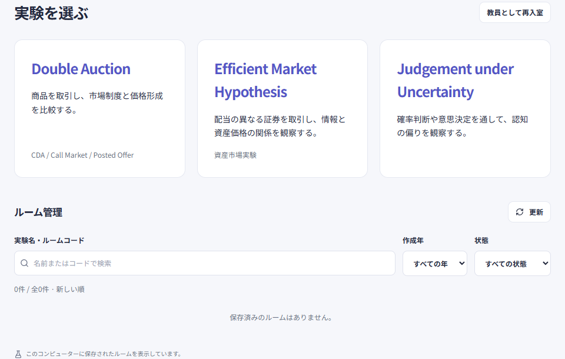
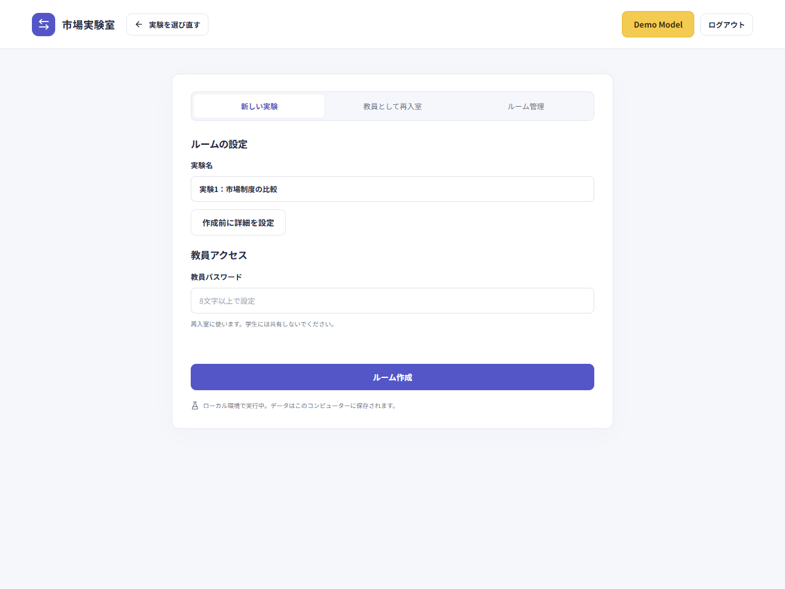
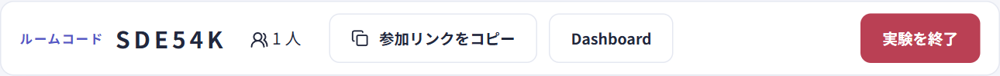
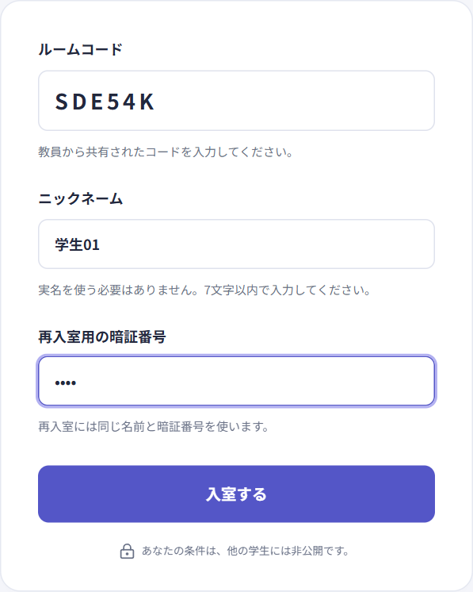
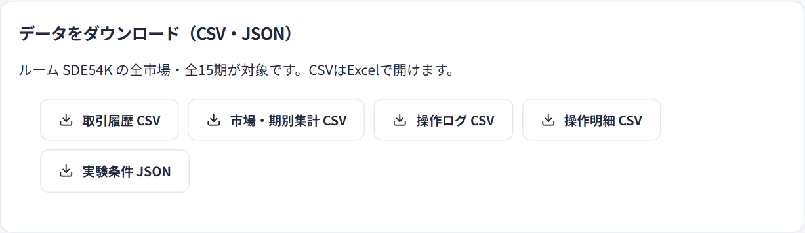

# プラットフォームの使い方

[日本語](../ja/classroom.md) · [中文](../zh-CN/classroom.md) · [English](../en/classroom.md)

[教員入口](https://exp-all-in-one.vercel.app/teacher) · [学生入口](https://exp-all-in-one.vercel.app)

ルーム作成、入室、実験の実施、結果のダウンロードまでの手順です。画面は日本語表示の操作例で、ローカル環境の説明用ルームを使っています。授業では上のオンライン入口をご利用ください。作成画面とダウンロード欄は Double Auction の例です。

## 1. 教員が実験を選び、ルームを作る

教員入口を開き、実施する実験を選びます。3つの実験は同じ入口を使い、保存済みのルームもここで管理します。

実験名を入力し、実施条件を確認します。このルームの教員パスワードを8文字以上で設定し、管理者から受け取った「教員用キー」を入力して「ルーム作成」を押すと、教員の管理画面が開きます。

EMHでは初期証券数・目標人数・タイプ比率・各期の時間を設定できます。受付中に保存し、分け方を確定すると条件がロックされます。詳細は[EMHの設定](emh.md)を参照してください。

| 項目                 | 使う人             | 用途                                                           |
| -------------------- | ------------------ | -------------------------------------------------------------- |
| 教員用キー           | 教員               | 管理者から受け取り、オンラインのルーム作成・管理一覧に使用     |
| 教員パスワード       | 教員               | 作成時に設定し、そのルームへの再入室に使用                     |
| ルームコード         | 教員から学生へ共有 | 参加する授業を特定するコード。教員パスワードとは別             |
| 4桁の暗証番号（PIN） | 各学生が設定       | 同じニックネームまたは学生証番号と組み合わせて本人として再入室 |

学生に必要なのは学生入口、ルームコード、自分の入室情報です。教員用キーと教員パスワードは共有しないでください。

## 2. 入口を共有し、学生が入室する

作成後、教員画面の6文字のルームコードと学生入口を全員に共有します。画面にある参加リンクも利用できます。下の「参加リンクをコピー」は、コードを入力済みのリンクをコピーします。

学生はリンクを開き、コードを確認してニックネームと自分で決めた4桁の暗証番号を入力し、「入室する」を押します。ニックネームは7文字以内で、教員の指示により学生証番号を入力する場合があります。Judgement under Uncertainty ではニックネーム欄が「学生証番号」になり、先頭の0を含む7桁の番号を入力します。実験はコードから判別されるため、学生が選ぶ必要はありません。

学生入口はルームコードで入室するための画面です。実施する実験とルールは教員が案内します。入室後は画面を開いたまま開始を待ち、教員の説明と各自の画面の案内に沿って参加してください。

## 3. 教員が人数を確認し、実験を実施する

教員画面で入室人数と設定を確認し、その実験の案内に沿って準備を終えてから開始します。準備の手順、グループ分け、開始条件は実験によって異なります。開始ボタンが表示されない、または押せない場合は、画面に示された手順を先に完了してください。

実施中、教員は全体の進み具合を確認し、その実験で用意された一時停止・再開・終了の操作を必要に応じて使います。学生は各自の画面で取引や回答を進めます。終了前に全員の状況を確認し、確認画面が出たら内容を読んでから操作してください。

## 4. 結果をダウンロードし、ルームを残す

教員画面のデータダウンロード欄で必要なファイルを選びます。Double Auction は **Dashboard** から下の欄を開きます。他の実験はそれぞれの教員画面の出力ボタンを使い、形式と項目は実験ごとに異なります。

Double Auction で対象の記録がまだない場合は、その旨が画面に表示されます。保存したファイルを授業での振り返りや分析に使えます。保存済みのルームには教員入口から戻れます。必要なデータは、ルームを削除する前にダウンロードしてください。

## 再入室とルーム管理

| やりたいこと                     | 操作                                                                                                         |
| -------------------------------- | ------------------------------------------------------------------------------------------------------------ |
| 教員がルームに戻る               | 「教員として再入室」を押し、コードと作成時の教員パスワードを入力                                             |
| 学生が別端末や閉じた画面から戻る | 学生入口で同じコード、ニックネームまたは学生証番号、元の暗証番号を入力                                       |
| 以前のルームを探す               | 教員入口の「ルーム管理」で教員用キーを入力して「ルームを表示」。実験名・コードで検索、作成年・状態で絞り込み |
| 保存済みの結果を見る             | 一覧の「結果・ダウンロード / 再入室」または「再入室」を押し、そのルームの教員パスワードを入力                |

ログイン状態はルーム・役割ごとに分離します。同じブラウザーの通常タブで教員画面と学生画面を同時に開けます。複数の学生として試す場合は、学生ごとに別端末・別ブラウザープロファイルを使ってください。

一覧は新しい順で、実験名・コード・作成日時・状態・市場数・入室人数・進行期・各制度の期数を表示し、20件ずつ追加表示できます。個人別の教員アカウントはなく、オンラインの作成と管理には共通の教員用キーを使います。ローカルでは、そのコンピューターで選んだ保存先のルームを表示します。

教員用キーで一覧を開くと入力欄は閉じ、同じページでの更新・削除に入力済みのキーを使います。ページを再読み込みした場合は再入力します。

削除は確認画面で「このルームを削除」を押します。教員パスワードの再入力は不要ですが、管理一覧の教員用キーはサーバーで検証します。キー未設定のローカル環境では不要です。参加者・市場・取引履歴・監査ログ・実験結果も一緒に削除され、実験中の学生もそのルームを利用できなくなります。削除は元に戻せません。

## 授業の前に試す

実験を選んだ後、教員ページ右上の **Demo Model** から教員用キーやルーム作成なしで試せます。入口は [Double Auction](https://exp-all-in-one.vercel.app/demo)、[EMH](https://exp-all-in-one.vercel.app/emh/demo)、[Judgement under Uncertainty](https://exp-all-in-one.vercel.app/judgment/demo) です。Judgement のデモは課題を選んで開始し、回答は保存せず、制限時間を停止した状態で確認します。詳しくは [Demo Model の使い方](demo.md) を参照してください。

旧アドレス `doubleauction.vercel.app` はパスとクエリを保って新アドレスへ転送します。旧アドレスで参加していた場合は、新アドレスで一度再入室してください。

---

[ホーム](../../../README.md) · [Double Auction](double-auction.md) · [Demo Model](demo.md) · [EMH 資産市場実験](emh.md) · [Judgement under Uncertainty](judgment.md) · [開発・デプロイ・検証](development.md)
