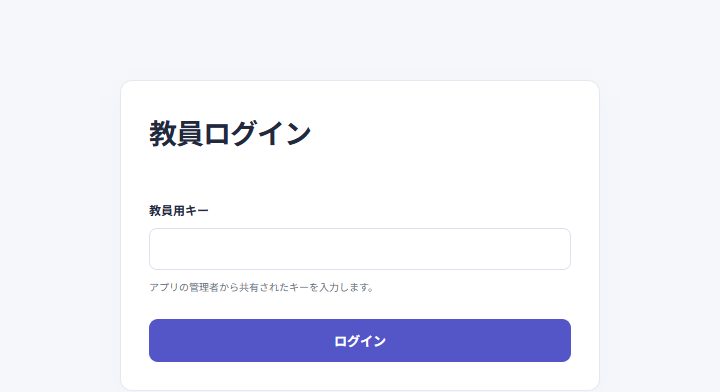
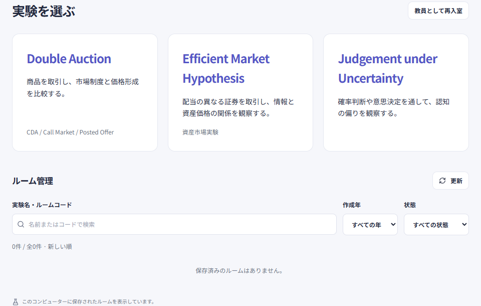
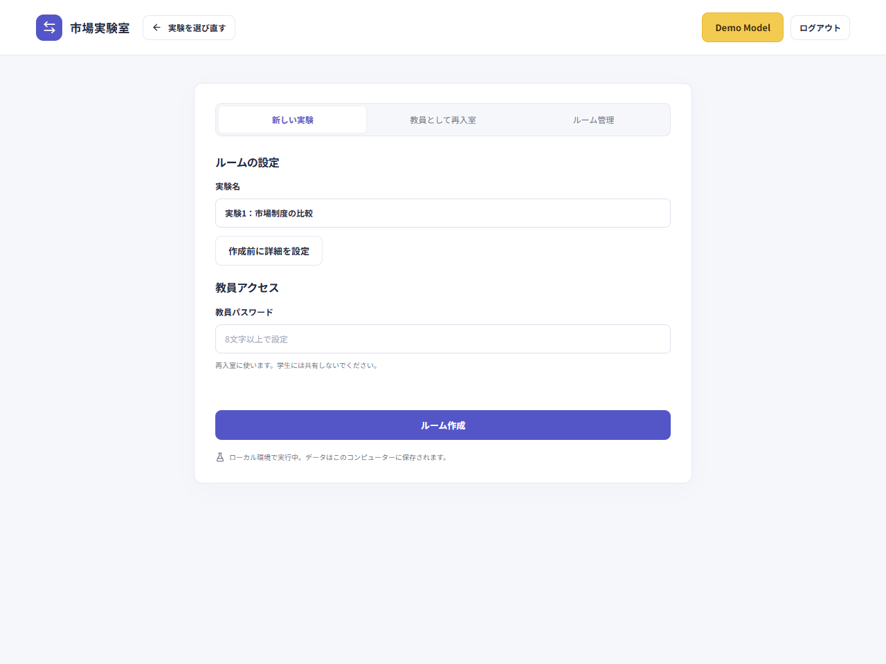
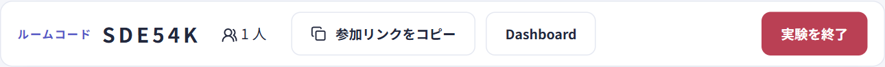
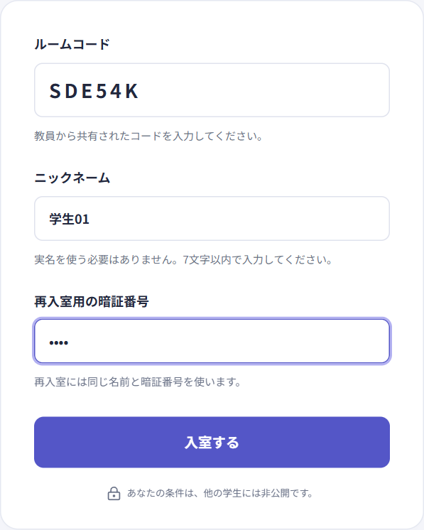
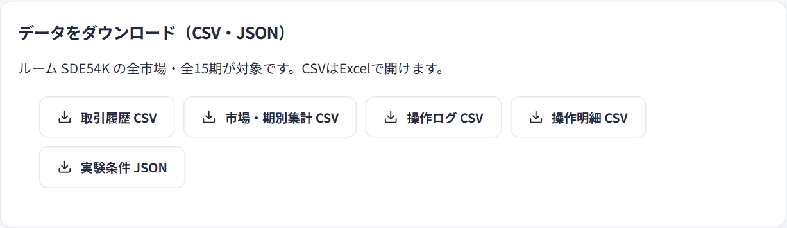

# 平台使用图解

[日本語](../ja/classroom.md) · [中文](../zh-CN/classroom.md) · [English](../en/classroom.md)

学生等待画面采用统一设计。EMH 在教师开始后先在学生画面中央显示5秒准备倒计时，结束后才开始交易。

[教师入口](https://exp-all-in-one.vercel.app/teacher) · [学生入口](https://exp-all-in-one.vercel.app)

先完成建房、加入、开展实验和下载结果。以下截图来自本地的虚构课堂，展示默认日语界面；实际授课请使用上方线上入口。建房及下载区域以 Double Auction 为例。

在实验设置和重新进入页面，可通过页眉的「戻る」返回实验选择。从 Double Auction 房间打开设置时，也可点击同一页眉中的「ルーム … に戻る」返回原房间。

Judgement 创建房间时，将任务卡片与已选内容、创建按钮并排显示；窄屏时操作区位于上方。语言切换和实验进行中的操作见 [Judgement 指南](judgment.md)。

CDA 和 EMH 的订单板都可在「一覧」和「棒グラフ」之间切换。学生端标识本人的订单，不显示其他参加者编号；每个实验模块分别维护自己的下单和结算规则。

## 1. 教师选择实验并创建房间

打开教师入口，输入管理员提供的「教員用キー」，点击「ログイン」。验证后选择实验，也可在同一入口管理已有房间。

填写实验名，确认设置，设置至少8个字符的房间教师密码。点击「ルーム作成」进入教师管理画面，不再输入教师密钥。

EMH可设置初始证券数、目标人数、类型比例及各期时长；开放加入期间保存设置，确认分组后锁定。详见[EMH设置](emh.md)。

| 项目                           | 谁使用           | 用途                                   |
| ------------------------------ | ---------------- | -------------------------------------- |
| 教师密钥「教員用キー」         | 教师             | 管理员提供，用于教师入口登录           |
| 房间教师密码「教員パスワード」 | 教师             | 创建时自行设置，用于重新进入这个房间   |
| 房间代码「ルームコード」       | 教师分享给学生   | 找到正确的课堂，不是教师密码           |
| 四位数字 PIN「暗証番号」       | 每位学生自己设置 | 配合同一昵称或学号，恢复自己的参与身份 |

学生只需要学生入口、房间代码和自己的身份信息。不要分享教师密钥或房间教师密码。

## 2. 分享入口，学生加入

建房后，将教师画面中的六位房间代码和学生入口发给全班；也可以使用画面提供的参加链接。下面的「参加リンクをコピー」会复制已包含房间代码的链接。

学生打开链接，核对房间代码，输入昵称和自己设置的四位数字 PIN，点击「入室する」。昵称限7个字符，按教师要求可能需要填写自己的学号。Judgement under Uncertainty 的昵称栏会显示「学生証番号」，需填写七位学号，保留开头的0；学生不需要选择实验，平台会按代码识别。

学生首页用于凭房间代码加入课堂。实验由教师安排并讲解规则；加入后保持页面打开，等待开始，再根据教师讲解和各自屏幕提示参加。

## 3. 教师确认人数并开展实验

在教师管理画面确认参加人数和设置，按当前实验的提示完成准备，再使用开始操作。不同实验的准备步骤、分组和开始条件不同；如果开始按钮尚未出现或不可用，先完成画面提示的步骤。

进行中，教师查看整体进度，按需要使用当前实验提供的暂停、继续或结束操作；学生在各自页面交易或答题。结束前确认全班进度，若出现结束确认框，阅读提示后再操作。

## 4. 下载结果，保留房间

在教师画面的数据下载区域选择所需文件。Double Auction 从 **Dashboard** 打开下面的区域；其他实验使用各自教师画面的导出按钮，文件格式和字段以该实验为准。

Double Auction 中尚未产生相应记录时，会提示暂无数据。保存文件后可以用于课堂讨论和分析。已有房间仍可从教师入口重新进入；需要的数据应在删除房间之前下载。

## 重新进入与房间管理

| 需要做什么                 | 操作                                                                                |
| -------------------------- | ----------------------------------------------------------------------------------- |
| 教师返回房间               | 点击「教員として再入室」，填写房间代码和创建时设置的教师密码                        |
| 学生换设备或关闭页面后返回 | 重新打开学生入口，使用同一房间代码、昵称或学号，以及原来的 PIN                      |
| 查找以前的房间             | 登录后在「ルーム管理」搜索实验名或代码，也可按创建年份或状态筛选                    |
| 回到已有房间查看数据       | 在房间列表中点击「結果・ダウンロード / 再入室」或「再入室」，再输入该房间的教师密码 |

登录状态按房间和角色分开，同一浏览器的普通标签页可以同时打开教师和学生画面。模拟多个学生时，每人使用独立设备或浏览器配置文件。

房间列表按新到旧排列，显示实验名、代码、创建时间、状态、市场数、参加人数、进度和各制度期数，每次可继续加载20条。平台没有个人教师账户；线上创建和管理使用共用教师密钥，本地显示该计算机选定数据库中的房间。

教师密钥只在教师入口输入一次。同一浏览器在8小时内，刷新、切换实验、创建和管理房间都无需再次输入。退出登录、会话到期或密钥更换后需重新验证；每个房间的教师密码仍单独保留。

删除房间时，在确认页面点击「このルームを削除」。无需再次输入房间教师密码，但服务端仍验证教师登录会话，未配置密钥的本地环境除外。删除会一并移除参加者、市场、交易历史、审计日志和实验结果，正在实验的学生也无法继续使用该房间；删除不可恢复。

## 上课前试用

从教师实验选择页的 **Demo Model** 打开统一列表并选择实验；直接打开下方链接同样需要教师登录。演示入口分别是 [Double Auction](https://exp-all-in-one.vercel.app/demo)、[EMH](https://exp-all-in-one.vercel.app/emh/demo) 和 [Judgement under Uncertainty](https://exp-all-in-one.vercel.app/judgment/demo)。Judgement 演示需先选择任务，不保存回答，计时限制暂停。更多操作见 [Demo Model 使用说明](demo.md)。

旧地址 `doubleauction.vercel.app` 保留路径和查询参数跳转至新地址；如果之前使用旧地址参加，需在新地址重新进入一次。

---

[首页](../../../README.zh-CN.md) · [Double Auction](double-auction.md) · [Demo Model](demo.md) · [EMH 资产市场实验](emh.md) · [Judgement under Uncertainty](judgment.md) · [开发、部署与验证](development.md)
